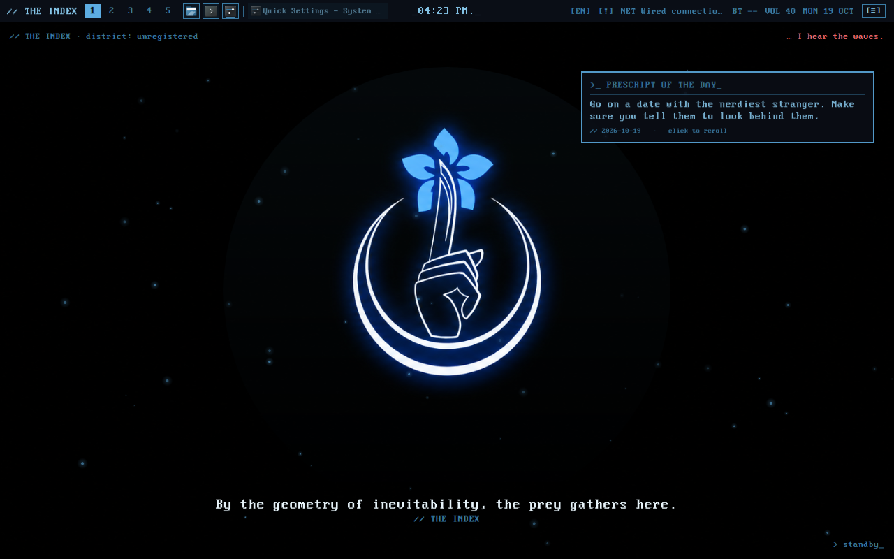

# WILL OF THE CITY :: THE INDEX

An INDEX-themed desktop built on KDE Plasma 6, KWin and Quickshell. Floating
windows, a top taskbar, and matching lock and login screens.



## Install with yay

You need an installed Arch-based system, working graphics drivers, internet,
and a normal user account with sudo. KDE does not need to be installed first.

INDEX isn't on the AUR yet. If you have yay, add our signed repository once,
then install:

```bash
curl -fLO https://github.com/HariUwU/index-OS/releases/download/pacman-repo/enable-index-repo.sh
bash enable-index-repo.sh
yay -Syu index-os
index-setup --manager yay
```

Run these as your normal user. Setup asks for sudo when needed.

### Using pacman instead

Add the same repository with the first two commands above, then run:

```bash
sudo pacman -Syu index-os
index-setup
```

Update with `yay -Syu` or `sudo pacman -Syu`. Run `index-setup` again to apply
updated files to your desktop. [Repository and signing key details](packaging/repo/README.md).

## Setup

Choose which parts to install. On a fresh Arch system, select **Desktop + Login
screen**. If you already use Plasma, the login screen is optional.

**Up/Down** moves, **Space** selects, **Enter** continues, and **Esc** cancels.
You review your choices before anything is installed.

Log out and back in after desktop setup. Reboot if you installed the login
screen. If you skip the login screen, use your existing display manager's
**Plasma (Wayland)** session, or run `startplasma-wayland` from a local text console.

## Your intro video and login music

The intro video and login background music are optional. To use your own, create
this folder and copy your files to the paths below:

```bash
mkdir -p ~/.local/share/index/assets/sounds
```

| File | Path |
|---|---|
| Intro video | `~/.local/share/index/assets/intro.mp4` |
| Login music | `~/.local/share/index/assets/sounds/bg.mp3` |

If you set `XDG_DATA_HOME`, use `$XDG_DATA_HOME/index/assets/` instead.

Setup pauses at **Optional video and music** before installing. You can copy
files from another terminal, press **R** to recheck, then **Enter** to continue.
You can also leave both files out. A fresh install will skip the intro and login
music; existing media and saved video choices are kept.

Select **Intro video** in setup to enable playback. To change it later, open
**Win+A → Settings → Intro Video**.

The wallpaper, logo, icons, sound effects and modified
`PerfectDOSVGA437-Universal.ttf` font are included.
[More about personal files](assets/README.md).

## Install from source

```bash
sudo pacman -Syu --needed git python
git clone https://github.com/HariUwU/index-OS.git
cd index-OS
bash install.sh
```

Or download the [RC13 source installer](https://github.com/HariUwU/index-OS/releases/download/v0.1.1rc13/index-os-0.1.1rc13-installer.tar.gz),
extract it, and run `bash install.sh` inside its folder. Keep the extracted files together.

Source installs also accept `assets/intro.mp4` and `assets/sounds/bg.mp3` in
the project folder. To use yay for dependencies, run `bash install.sh --manager yay`.
To preview a selection, run `bash install.sh --components desktop,login --dry-run`.

## Notes

This is a release candidate tested in an Arch VirtualBox VM. The screenshot
above is from that VM.

- [Desktop settings and restoration](DESKTOP.md)
- [Local package installation and removal](packaging/arch/README.md)
- [Credits and font information](ATTRIBUTION.md)
- [License](LICENSE)

The previous labwc version is on the [`old` branch](https://github.com/HariUwU/index-OS/tree/old).
